<p align="center">
  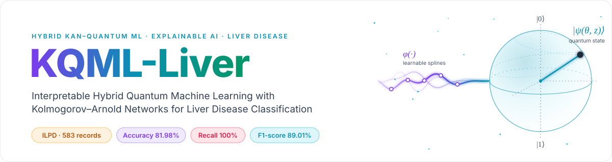
</p>

<p align="center">
  
  <a href="KQML-Liver%20Interpretable%20Hybrid%20Quantum%20Machine%20Learning%20with%20Kolmogorov%E2%80%93Arnold%20Networks%20for%20Liver%20Disease%20Classification.pdf"></a>
  <a href="https://doi.org/10.24432/C5D02C"></a>
  <a href="https://arxiv.org/abs/2404.19756"></a>
  
</p>

<p align="center">
  <a href="#introduction">Introduction</a> ·
  <a href="#proposed-method">Proposed Method</a> ·
  <a href="#main-contributions">Main Contributions</a> ·
  <a href="#experimental-results">Results</a> ·
  <a href="#intrinsic-model-interpretability">Interpretability</a> ·
  <a href="#citation">Citation</a>
</p>

> [!NOTE]
> **Under review at Engineering Applications of Artificial Intelligence (Q1, Scimago)**

## Introduction

Liver disease remains a major global health concern, causing more than **two million deaths annually**. Early diagnosis is therefore essential, yet many existing **Machine Learning (ML)**, **Deep Learning (DL)**, and **Quantum Machine Learning (QML)** approaches still face several limitations:

- Limited interpretability in high-stakes clinical settings
- Reduced reliability on small and imbalanced medical datasets
- Inflated performance caused by data leakage or inconsistent evaluation protocols
- High computational requirements for purely quantum or deep architectures

To address these challenges, this paper proposes **KQML-Liver**, an interpretable hybrid framework for liver disease classification.

## Proposed Method

**KQML-Liver** integrates:

- **Kolmogorov–Arnold Networks (KANs)** for nonlinear feature learning and intrinsic interpretability
- A lightweight **Parameterized Quantum Circuit (PQC)** for modeling complementary higher-order feature interactions
- **Feature augmentation** using PCA, Factor Analysis, LDA, and a nonlinear trigonometric transformation
- **Effective Number of Samples (ENS)** weighting with power scaling and smoothing for class-imbalance handling
- **Focal Loss** to emphasize difficult training examples
- A strict **data-leakage-free evaluation protocol**

<p align="center">
  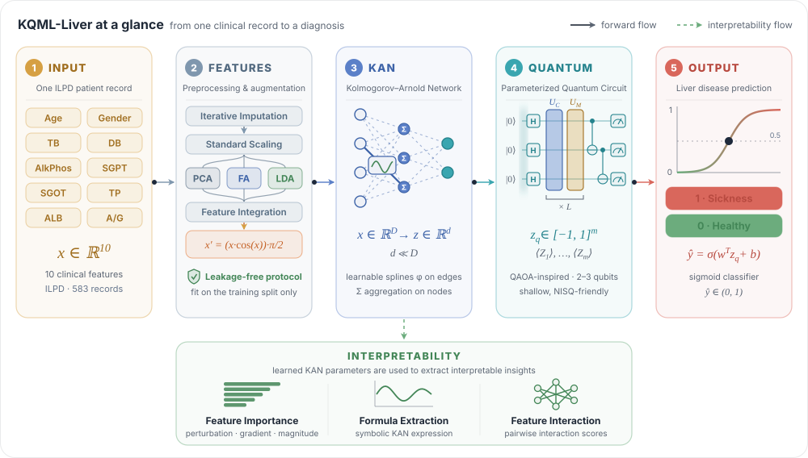
</p>

The complete framework first enriches the original clinical features, compresses them into a compact latent representation using KAN, and then processes the latent features using a shallow quantum circuit. The final prediction is generated through a sigmoid classifier.

| | |
|---|---|
| **Input** | One ILPD patient record with 10 clinical features: Age, Gender, TB, DB, AlkPhos, SGPT, SGOT, TP, ALB, A/G |
| **Output** | $\hat{y} \in (0, 1)$ from the sigmoid classifier → **1: Sickness** / **0: Healthy** |

<details>
<summary><b>Paper figure</b> · Overall architecture</summary>
<p align="center">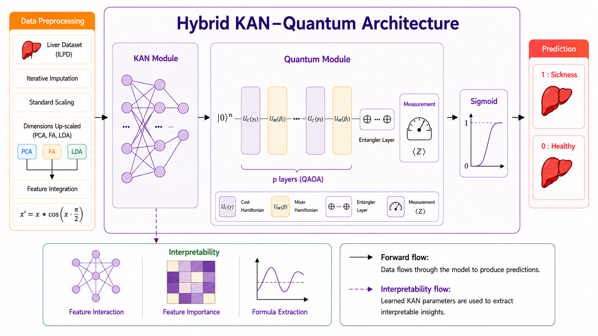</p>
</details>

## Main Contributions

### 1. Feature Augmentation and Nonlinear Transformation

A feature-enrichment strategy is introduced to overcome the limited representational capacity of the original ILPD feature space.

<p align="center">
  
</p>

PCA, Factor Analysis, and LDA are applied in parallel to capture:

- Variance-based information
- Latent statistical structure
- Class-discriminative information

Their outputs are integrated with the original features and transformed using:

```math
x' = (x \cdot \cos(x)) \cdot \frac{\pi}{2}
```

This transformation enriches nonlinear structure and produces values suitable for quantum rotation-angle encoding.

<details>
<summary><b>Paper figure</b> · Feature augmentation pipeline</summary>
<p align="center">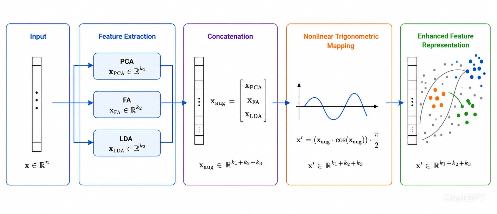</p>
</details>

### 2. Hybrid KAN–Quantum Architecture

The proposed architecture combines the strengths of classical functional learning and quantum feature processing.

The complete end-to-end prediction pipeline is expressed as:

```math
\mathbf{z}=f_{\mathrm{KAN}}(\mathbf{x}),
\qquad
\hat{y}=\mathrm{sigmoid}\left(g\left(U(\mathbf{z})\left|0\right\rangle^{\otimes m}\right)\right)
```

where the KAN transforms the enriched input vector into a compact latent representation, while the parameterized quantum circuit models complementary higher-order interactions.

#### KAN-Based Feature Learning

<p align="center">
  
</p>

Unlike a conventional multilayer perceptron, which places fixed activation functions on nodes, KAN places learnable univariate functions on network edges.

The latent representation is produced by composing multiple KAN layers:

```math
\mathbf{z} = f_L \circ f_{L-1} \circ \cdots \circ f_1(\mathbf{x})
```

At layer l, the output of node j is computed by aggregating the transformed outputs from all nodes in the previous layer:

```math
h_j^{(l)} = \sum_{i=1}^{m_{l-1}} \phi_{i,j}^{(l)}\left(h_i^{(l-1)}\right)
```

This edge-level functional parameterization allows KAN to learn complex nonlinear relationships while preserving interpretability through the shapes of the learned spline functions.

<details>
<summary><b>Paper figure</b> · KAN module</summary>
<p align="center">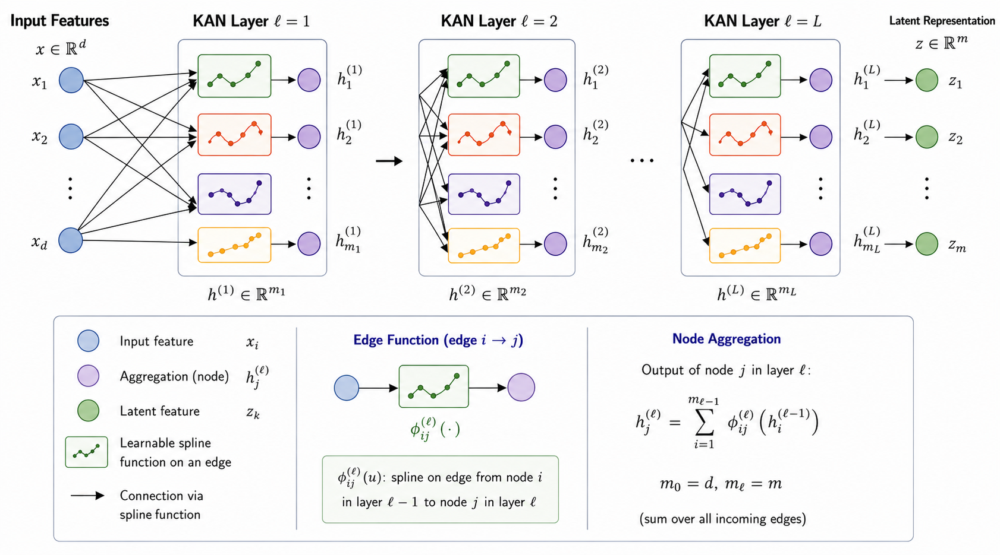</p>
</details>

#### Quantum Feature Processing

<p align="center">
  
</p>

The compact KAN representation is encoded into an m-qubit quantum circuit.

The QAOA-inspired quantum embedding alternates between a cost unitary and a mixer unitary:

```math
\left|\psi(\theta,\mathbf{z})\right\rangle
=
U_M(\beta_L)U_C(\gamma_L,\mathbf{z})
\cdots
U_M(\beta_1)U_C(\gamma_1,\mathbf{z})
\left|\psi_0\right\rangle
```

The cost Hamiltonian encodes both individual latent features and pairwise feature interactions:

```math
H_C = \sum_{i=1}^{m} z_i Z_i + \sum_{i=1}^{m-1}\sum_{j=i+1}^{m} J_{ij} Z_i Z_j
```

The mixer Hamiltonian promotes exploration of the quantum state space:

```math
H_M = \sum_i X_i
```

After the QAOA-inspired layers, CNOT gates introduce additional inter-qubit correlations. Each qubit is then measured in the Pauli-Z basis:

```math
\mathbf{z}_q = \left[\langle Z_1\rangle, \langle Z_2\rangle, \ldots, \langle Z_m\rangle\right] \in [-1,1]^m
```

This design captures higher-order interactions while remaining compatible with the limited resources available in the **NISQ era**.

<details>
<summary><b>Paper figure</b> · Quantum module</summary>
<p align="center">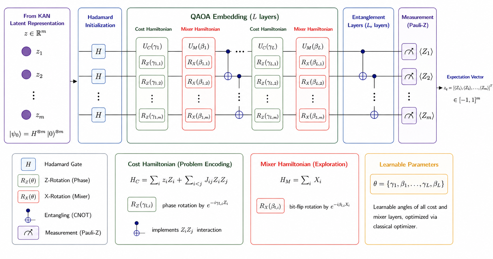</p>
</details>

### 3. Class-Imbalance Handling Without Synthetic Resampling

KQML-Liver preserves the original ILPD data distribution and addresses imbalance using an enhanced **Effective Number of Samples (ENS)** strategy:

```math
w_c = \frac{1-\beta}{1-\beta^{n_c}}
```

The raw class weights are further refined using power scaling and smoothing:

```math
w_c \leftarrow w_c^\gamma,
\qquad
w_c \leftarrow 1 + \alpha_{\mathrm{smooth}}(w_c - 1)
```

The resulting weights are normalized to unit mean, reducing excessive penalties while improving minority-class learning. Focal Loss is additionally used to focus training on difficult examples.

## Dataset

The model is evaluated on the **Indian Liver Patient Dataset (ILPD)** from the UCI Machine Learning Repository.

| Property | Value |
|---|---:|
| Number of records | 583 |
| Clinical input features | 10 |
| Positive liver-disease cases | 416 |
| Negative cases | 167 |
| Task | Binary classification |

The original class distribution is preserved, and no synthetic resampling is applied during evaluation.

## Experimental Results

Under a unified and leakage-free evaluation protocol, KQML-Liver achieves:

| **Accuracy** | **Precision** | **Recall** | **F1-score** |
|:---:|:---:|:---:|:---:|
| **81.98%** | **80.20%** | **100.00%** | **89.01%** |

The model successfully identifies all positive liver-disease cases in the test set, which is especially important in medical screening because false-negative predictions may delay diagnosis and treatment.

KQML-Liver also achieves competitive or superior performance compared with reproduced classical, hybrid, and quantum-learning baselines evaluated under the same protocol.

<p align="center">
  
</p>

<details>
<summary><b>Full comparison table</b> (Table 1 of the paper)</summary>

| Author | Model | Acc. | Prec. | Rec. | F1 |
|---|---|---:|---:|---:|---:|
| Quadir et al. | Extra Trees | 0.7402 | 0.7647 | 0.9218 | 0.8354 |
| Amin et al. | RF+PCA+LDA+FA | 0.7200 | 0.7710 | 0.8680 | 0.8160 |
| Alyasin & Ata | Hybrid baseline | 0.8003 | 0.8028 | 0.9572 | 0.8700 |
| Kumar & Thakur | V-NWFKNN | 0.8100 | 0.8073 | 0.9424 | 0.8800 |
| Kumar & Thakur | V-NWFKNN (TL-RUS) | 0.8173 | 0.7982 | 0.9601 | 0.8900 |
| Safriandono et al. | LR-QFE | 0.7400 | 0.7500 | 0.9900 | 0.8500 |
| Donaire et al. | QML-Liver | 0.7500 | 0.7500 | 0.9400 | 0.8343 |
| **Ours** | **KQML-Liver** | **0.8198** | **0.8020** | **1.0000** | **0.8901** |

</details>

## Intrinsic Model Interpretability

The framework provides model transparency from three complementary perspectives:

- **Feature importance analysis** using perturbation, gradient sensitivity, and intrinsic KAN magnitude
- **Symbolic formula extraction** from learned KAN functions
- **Pairwise feature-interaction analysis**

The analysis identifies **Total Bilirubin (TB)** as the most influential feature, followed by the **Albumin/Globulin ratio**, **SGOT**, **Total Protein**, and **SGPT**.

The extracted symbolic representation can also support lightweight deployment because it can be evaluated without storing the full neural network or requiring a deep-learning framework.

<details>
<summary><b>Paper figure</b> · Feature interaction analysis</summary>
<p align="center">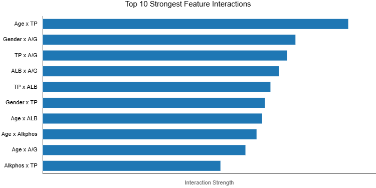</p>
</details>

## Why KQML-Liver?

KQML-Liver is designed to provide a practical balance between:

| | | |
|:---:|:---:|:---:|
| Predictive performance | Clinical sensitivity | Model transparency |
| Robustness to data leakage | Small-data learning | Quantum-resource efficiency |

Rather than relying on a large quantum circuit, the KAN module first produces a compact and informative representation. The quantum component can therefore remain shallow and focus on modeling residual higher-order interactions.

## Paper

**Title:** KQML-Liver: Interpretable Hybrid Quantum Machine Learning with Kolmogorov–Arnold Networks for Liver Disease Classification

**Authors:** Nhat-Long Nguyen · Viet-Loi Dinh · Trong-Nghia Pham

**Affiliation:** Faculty of Information Technology, University of Science, Vietnam National University, Ho Chi Minh City, Vietnam

## Citation

The citation information will be updated after the paper is officially published.

```bibtex
@article{nguyen2026kqmlliver,
  title     = {KQML-Liver: Interpretable Hybrid Quantum Machine Learning with Kolmogorov--Arnold Networks for Liver Disease Classification},
  author    = {Nguyen, Nhat-Long and Dinh, Viet-Loi and Pham, Trong-Nghia},
  journal   = {Engineering Applications of Artificial Intelligence},
  year      = {2026},
  note      = {Under review}
}
```

## Acknowledgments

This research is supported by research funding from the **Faculty of Information Technology, University of Science, Vietnam National University – Ho Chi Minh City**.
